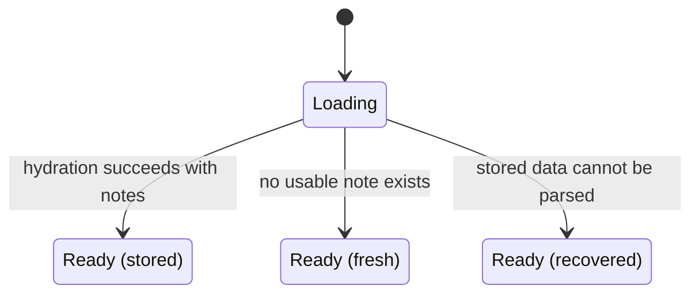
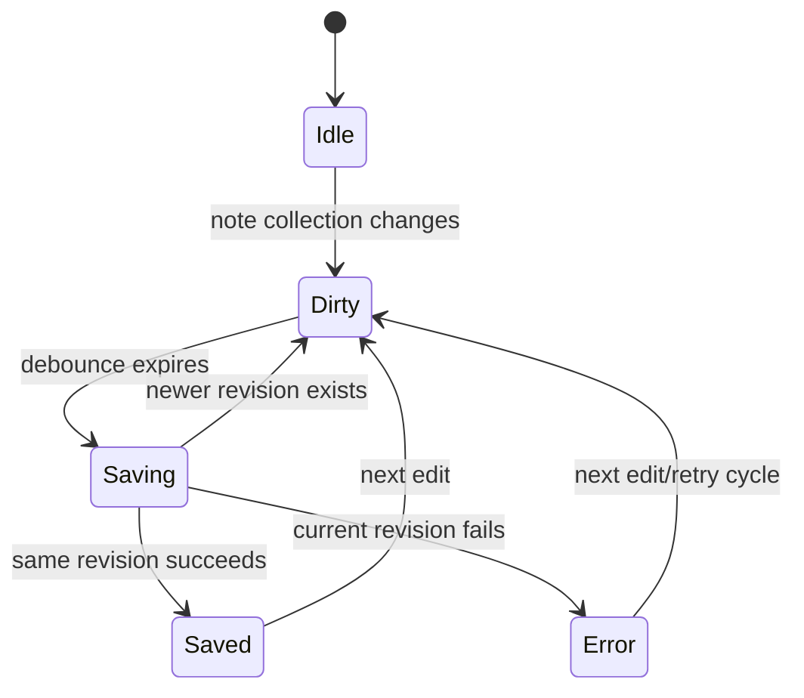
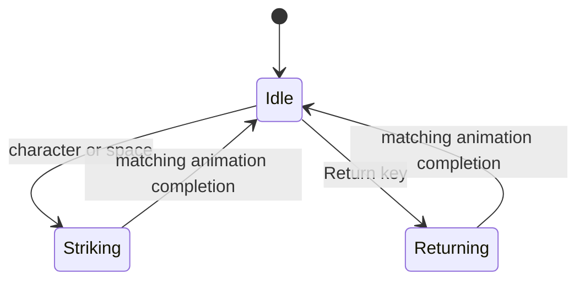
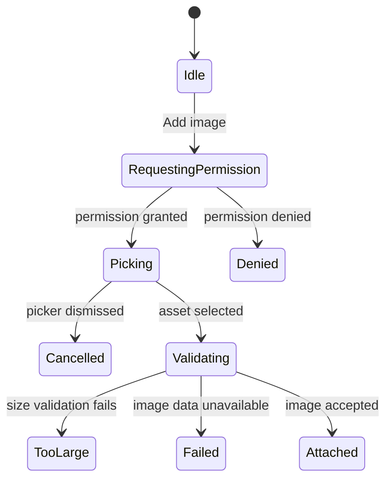
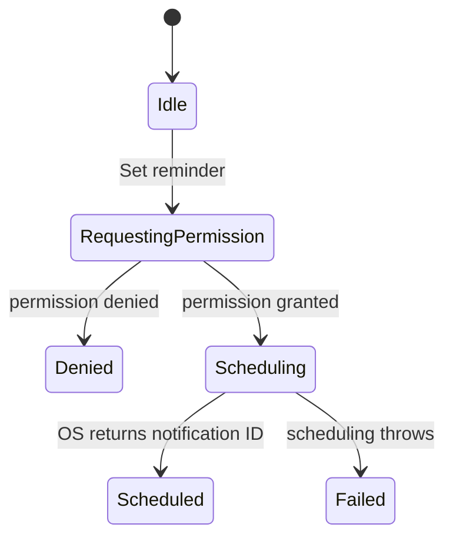

# Mothlight state machines

The UI is rendered in `App.tsx`; pure state transitions live in `src/stateMachines.ts`. Reducers decide whether an event is valid and what state follows. Effects in the app perform the corresponding platform work (AsyncStorage, keyboard notifications, audio/haptics, image picker, notifications, and animations).

## State inventory

| Flow | States | Main events |
|---|---|---|
| Startup | `loading → ready(stored / fresh / recovered)` | `HYDRATED` |
| Navigation | `editor / library`, with an optional editor panel | `OPEN_EDITOR`, `OPEN_LIBRARY`, `OPEN_PANEL`, `CLOSE_PANEL` |
| Toolbar | `expanded / collapsed` | `TOGGLE`, `EXPAND`, `COLLAPSE` |
| Keyboard | `hidden / visible` | native `SHOW` and `HIDE` |
| Typewriter | `idle → striking → idle` or `idle → carriage-returning → idle` | `KEYSTROKE`, matching `ANIMATION_FINISHED` |
| Editor history | bounded undo/redo snapshots | `RECORD`, `UNDO`, `REDO`, `RESET` |
| Autosave | `idle / dirty / saving / saved / error` | `DIRTY`, `SAVE_STARTED`, `SAVE_SUCCEEDED`, `SAVE_FAILED` |
| Attachment | `idle → requesting-permission → picking → validating → attached` | permission, picker, validation, and completion events |
| Reminder | `idle → requesting-permission → scheduling → scheduled` | permission and scheduling events |
| Search | `closed / editing / found / not-found` | `OPEN`, `QUERY_CHANGED`, `FOUND`, `NOT_FOUND`, `CLOSE` |
| Writing helper | `closed / ready(ideas or smart) / preview` | `OPEN`, `PREVIEW`, `DISCARD`, `APPLY`, `CLOSE` |

## Transition diagrams

### Startup and persistence





Each note snapshot receives a monotonically increasing revision. Writes are serialized through a promise queue, and a completion event can mark the UI as saved only when it belongs to the latest revision. This prevents slow writes from overwriting newer edits.

### Editing and typewriter



Paste operations do not trigger a physical key strike. Backspace still produces its audio/haptic feedback but intentionally skips the typebar strike. Animation callbacks carry a sequence number; callbacks from interrupted/older animations are ignored.

Undo/redo are reducer-managed snapshots (maximum 60 entries per direction). A new edit clears the redo branch. Creating, duplicating, opening, or deleting a note resets history so snapshots cannot leak between notes.

### OS-backed flows





Only one attachment picker or reminder scheduling operation can be active at a time. Reducers reject events that arrive out of order. The operating system still owns the native permission dialogs, picker and notification scheduler.

## Invariants

1. A panel can only be opened while the editor screen is active; navigation to the library always closes panels.
2. Startup must reach a hydrated state before note autosave begins.
3. Only the current save revision can display the saved state.
4. Typewriter animation completion is sequence-checked to ignore stale callbacks.
5. A new edit clears redo history; history never crosses note boundaries.
6. Attachments and reminders must pass permission and intermediate states before reaching success.
7. Search and helper results are represented as typed states rather than empty-string sentinels.
8. Platform side effects remain outside reducers, keeping transitions pure and independently testable.

## Verification

Run:

```sh
npm run typecheck
npm run test:states
```

The GitHub Actions workflow runs both commands after checking Expo dependency compatibility.
